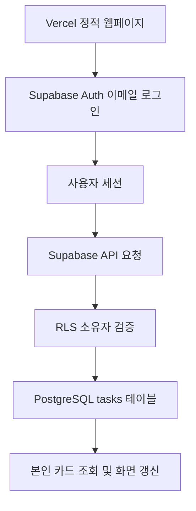

# Supabase 개인 칸반 보드 아키텍처 및 배포 안내

## 1. 변경 요약

기존 카드 저장소인 localStorage를 제거하고, Supabase Auth와 PostgreSQL을 사용하도록 변경했습니다. 생성·수정·삭제·상태 이동·백업 복원은 서버에 요청하며 성공 후 보드를 다시 읽습니다. 실패 시 성공으로 표시하거나 대화상자를 닫지 않습니다. 카드 데이터의 브라우저 저장 대체 경로는 없습니다.

프로젝트 URL과 공개 키가 아직 없으므로 config.js는 빈 값입니다. 이 배포본만 업로드해서는 로그인이 작동하지 않으며, 아래 Supabase 설정이 먼저 필요합니다. 기존 Vercel 프로젝트에 실제 배포하거나 외부 DB를 생성한 것은 아닙니다.

## 2. 파일 구조

```text
index.html      화면 및 로그인 폼, 스크립트 연결
style.css       원본 반응형 디자인
config.js       Supabase 프로젝트 URL과 공개 키
script.js       인증, 카드 조회·변경, 검색, 백업·복원
schema.sql      테이블, 인덱스, RLS 정책, 원자적 복원 함수
아키텍처.md     배포 절차와 동작 설명
```

## 3. 구성 및 데이터 흐름



- Vercel은 정적 파일을 제공합니다. 별도 서버 함수나 빌드 단계는 필요 없습니다.
- Supabase 공식 JavaScript 클라이언트를 CDN에서 로드합니다. 운영 환경에서는 정확한 SDK 버전을 고정하거나 자체 번들링하는 것이 좋습니다.
- 이메일/비밀번호 인증을 사용하며, 로그인한 사용자는 본인 카드만 조회·변경할 수 있습니다.
- 인증 세션은 sessionStorage에 저장됩니다. 이는 인증 토큰용이며 카드 데이터 저장소가 아닙니다. 일반적으로 탭을 닫으면 세션이 사라지며, 탭 간 로그인 상태 공유는 제공하지 않습니다.
- 자동 토큰 갱신은 SDK가 처리합니다.
- 서버 변경이 성공하면 목록을 다시 조회합니다. 다른 기기에서 발생한 변경은 새로고침으로 반영됩니다. 실시간 구독은 포함하지 않았습니다.
- 동시 수정 충돌은 마지막으로 성공한 쓰기가 반영되는 방식입니다. 낙관적 잠금이나 변경 이력은 없습니다.

## 4. Supabase 최초 설정

1. Supabase에서 새 프로젝트를 만듭니다.
2. SQL Editor에서 동봉한 schema.sql 전체를 실행합니다. 새 프로젝트용 스크립트이므로 기존 tasks 테이블이 있으면 그대로 실행하지 마세요. 재실행용 마이그레이션 스크립트는 아닙니다.
3. Authentication의 이메일 로그인 공급자를 활성화하고 이메일 확인을 켭니다.
4. Authentication URL 설정의 Site URL에 실제 Vercel 서비스 주소를 등록합니다.
5. Redirect URLs에도 실제 서비스 주소를 등록합니다. 예: `https://내프로젝트.vercel.app` 및 필요한 루트 경로. 프리뷰 주소를 사용할 경우 허용 대상을 별도로 확인하세요.
6. 프로젝트의 API 설정에서 Project URL과 publishable 키(또는 기존 anon 키)를 확인합니다.
7. config.js의 url과 publishableKey에 해당 값을 입력합니다.

```javascript
window.SUPABASE_CONFIG = {
  url: "https://YOUR_PROJECT.supabase.co",
  publishableKey: "YOUR_PUBLIC_PUBLISHABLE_KEY"
};
```

**service_role 키, secret 키, DB 비밀번호는 절대로 프런트엔드 파일에 넣지 마세요.** 공개 키는 브라우저에 노출되는 값이며, 데이터 보호는 공개 키를 숨기는 것이 아니라 RLS 정책으로 처리합니다.

이 정적 구성은 Vercel 환경변수를 자동으로 읽지 않습니다. config.js를 직접 설정하세요. 환경변수 주입이 필요하면 빌드 단계를 별도로 도입해야 합니다.

이메일 인증 발송 제한이나 운영용 발송량은 Supabase 설정에 따라 다릅니다. 실제 사용자 운영 전 SMTP와 인증 메일 발송 설정을 확인하세요. 비밀번호 재설정 UI는 이번 범위에 포함하지 않았습니다.

## 5. Vercel 배포

1. 기존 단일 HTML은 별도로 백업합니다. 기존 브라우저 카드가 필요하다면 기존 보드의 백업 버튼으로 JSON을 먼저 받습니다.
2. 동봉한 index.html, style.css, script.js, config.js를 기존 Vercel 프로젝트의 정적 배포 루트에 둡니다.
3. 기존 프로젝트가 별도 프레임워크/빌드 구조라면 해당 프로젝트의 정적 파일 배포 경로에 맞게 배치해야 합니다. 저장소 구조는 제공받지 않았으므로 특정 빌드 설정을 변경하지 않았습니다.
4. Git 연동 배포를 사용하는 경우 변경을 커밋·푸시해 재배포합니다.
5. 배포된 주소에서 회원가입하고 인증 이메일을 확인한 후 로그인합니다.
6. 기존 백업 JSON이 있다면 로그인 후 복원 버튼으로 업로드합니다.

schema.sql과 이 문서는 운영 정적 배포에 반드시 포함할 필요는 없습니다. SQL은 Supabase SQL Editor에서 실행하는 파일입니다.

## 6. 데이터 모델 및 접근 권한

| 필드 | 역할 |
| --- | --- |
| id | UUID 작업 식별자 |
| user_id | auth.users의 사용자 ID, 소유자 |
| title | 필수 제목, 최대 150자 |
| description | 메모, 최대 5,000자 |
| status | todo / doing / done |
| priority | low / medium / high |
| due | 선택 마감일, PostgreSQL date |
| created | 생성 시각, 밀리초 정수 |
| updated_at | DB 트리거로 갱신하는 수정 시각 |

RLS는 SELECT·INSERT·UPDATE·DELETE 각각에 대해 auth.uid()와 user_id가 같은 행만 허용합니다. UPDATE는 기존 행 접근과 변경 결과의 소유자를 모두 확인합니다. 비로그인 anon 역할에는 카드 테이블 권한을 주지 않습니다. 사용자 계정을 삭제하면 소유 카드도 연쇄 삭제됩니다.

브라우저의 사용자 ID 필터는 편의 기능일 뿐 보안 경계가 아닙니다. 실제 권한은 PostgreSQL RLS가 강제합니다. 배포 전 SQL 정책 적용을 반드시 확인하세요.

## 7. 백업 및 복원

- 기존 모아 version 1 JSON 백업 형식을 유지합니다.
- 복원 시 로그인한 사용자 자신의 목록 전체를 교체하며 다른 사용자 데이터는 변경하지 않습니다.
- 기존 백업 ID는 다른 계정의 카드 ID와 충돌하지 않도록 새 UUID로 발급합니다.
- replace_my_tasks 함수는 SECURITY INVOKER로 실행되므로 호출자의 RLS를 따릅니다.
- 삭제와 삽입은 단일 DB 트랜잭션입니다. 한 항목이라도 서버 검증에 실패하면 삭제까지 함께 롤백됩니다.
- 백업에는 암호화되지 않은 작업 정보가 포함됩니다. 안전한 위치에 보관하세요.
- 브라우저 저장소에서 기존 데이터를 자동 업로드하지 않습니다. 기존 보드에서 백업 후 새 보드에서 복원하세요. 카드의 소유자는 복원 당시 로그인 계정이 됩니다.

## 8. 확인 사항 및 테스트 범위

로컬 정적 검사에서 JavaScript 구문과 파일 연결, localStorage 카드 저장 코드 제거 여부를 확인했습니다. 실제 Supabase 프로젝트가 아직 없어 DB SQL 실행, 인증 이메일, RLS, Vercel 실서비스 동작은 검증하지 못했습니다.

배포 후 다음 순서로 확인하세요.

1. 비로그인 상태에서 개인 보드가 보이지 않는지 확인합니다.
2. 계정 A로 가입·인증·로그인하고 카드를 추가·수정·이동·삭제합니다.
3. 새로고침 후 동일 데이터가 불러와지는지 확인합니다.
4. 계정 B로 로그인해 A의 카드가 보이지 않는지 확인합니다.
5. A의 JWT와 B의 카드 ID를 사용한 직접 API 조회·수정·삭제가 허용되지 않는지 확인합니다. 화면에서만 숨겨지는 것으로 테스트를 끝내지 마세요.
6. JSON 백업과 복원을 확인하고, 다른 계정 데이터가 유지되는지 확인합니다.
7. 네트워크를 끊은 상태에서 변경이 저장 성공으로 표시되지 않는지 확인합니다.

## 9. 참고 자료

- [Supabase Auth](https://supabase.com/docs/guides/auth)
- [Row Level Security](https://supabase.com/docs/guides/database/postgres/row-level-security)
- [인증 세션](https://supabase.com/docs/guides/auth/sessions)
